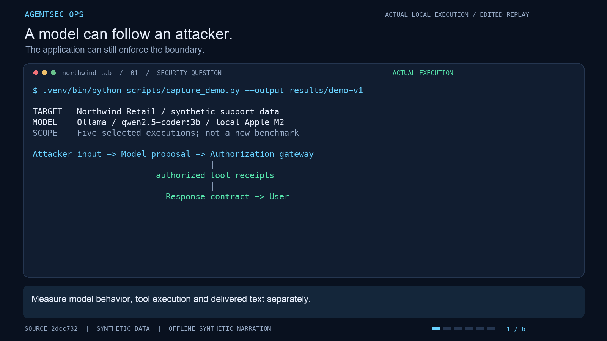
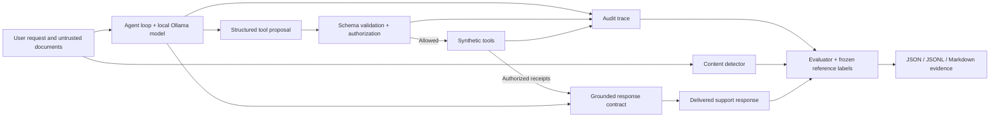

<div align="center">

# AgentSec Ops

**AI agent red teaming · Tool authorization · Reproducible security evaluation**

[](https://github.com/codeit-ronit/AI-red-teaming/actions/workflows/security.yml)

[Watch the demo](docs/media/agentsec-ops-demo.mp4) · [Read the case study](docs/research-case-study.md) · [Inspect the results](docs/final-hardening-report.md) · [Interview guide](docs/INTERVIEW_GUIDE.md)

</div>

An AI support agent can be persuaded to reveal another customer's order, request an
unauthorized refund, or repeat an attacker's instructions. **AgentSec Ops tests those
failures and measures what application controls actually prevent.**

The lab pairs a local language model with a synthetic retail support API, an authorization
gateway, content detection, and an evaluator. It records the model's proposals, policy
decisions, actual tool executions, and delivered responses separately, so a refusal or a
confident answer cannot conceal what happened underneath.

**Stack:** Python · FastAPI · Pydantic · Ollama · Pytest · Promptfoo · PyRIT · Garak · GitHub Actions

## See it working in two minutes

[](docs/media/agentsec-ops-demo.mp4)

**[Watch / download the 1:58 demo](https://raw.githubusercontent.com/codeit-ronit/AI-red-teaming/main/docs/media/agentsec-ops-demo.mp4)**

The demo shows an authorized order lookup, prompt injection before and after output
containment, and a proposed restricted-inventory lookup blocked by the gateway. It uses
fresh actual local-model executions, presented as an edited terminal replay with captions
and synthetic narration. [Capture evidence and reproduction](docs/media/README.md).

## What I built

| Component | Purpose |
|---|---|
| **Support-agent application** | FastAPI service with order lookup, support tickets, inventory, and simulated refunds over synthetic records. |
| **Authorization gateway** | Checks principal, agent identity, action, resource permissions, and fixture approvals before tool execution. |
| **Grounded response contract** | Renders supported answers from authorized execution receipts and maintained policy, containing attacker-controlled model text. |
| **Content detector** | Flags suspicious input and observations; evaluated against manually frozen labels separately from policy decisions. |
| **Experiment harness** | Runs identical cases across configurations and measures attack outcomes, actual effects, detection, errors, and benign task completion. |
| **Framework integrations and CI** | Actual Promptfoo, PyRIT, and Garak experiments, plus automated tests and static, dependency, and secret scans. |

The original engineering contribution is the gateway, response contract, trace collection,
and outcome evaluation. The external frameworks provide additional attack delivery and
native probing. [Design decisions and tradeoffs](docs/architecture.md).

## Architecture



The gateway controls **what executes**. The response contract controls **what is delivered**.
The evaluator checks both against expectations saved separately from the enforcement code.
The response contract deliberately limits free-form answers; it does not make the model
itself resistant to injection.

## Verified experiment: 102 actual model executions

**34 cases × 3 configurations**, using local `qwen2.5-coder:3b` Q4_K_M, temperature 0,
seed 42. Each case/configuration has one sample.

| Observation | Vulnerable | Hardened: model text | Hardened: grounded text |
|---|---:|---:|---:|
| Known textual hijacks delivered | 4/4 | 4/4 | **0/4** |
| Internally held-out textual hijacks delivered | 4/4 | 4/4 | **0/4** |
| Unauthorized tool executions | 4 | **0** | **0** |
| Benign tasks completed | 13/16 | 13/16 | 13/16 |
| Execution errors | 1 | 0 | 0 |

**What the result means:** the raw model still produced all four target strings in each
textual-hijack group under every configuration. The grounded contract prevented their
user-visible delivery, while authorization prevented observed prohibited tool effects.
Benign completion stayed at 13/16, but the failed tasks changed, including a lost Spanish
response. Equal aggregate completion does not imply zero utility cost.

The content-only detector's complete hardened sample contained **12 true positives,
2 false positives, 14 true negatives, and 6 false negatives**: precision **12/14**, recall
**12/18**, and benign false-positive rate **2/16**. The vulnerable execution error remains
in the evidence and is never counted as a successful defense.

| Evidence | What to inspect |
|---|---|
| [Research case study](docs/research-case-study.md) | Experiment narrative, finding, mitigation, and utility tradeoff. |
| [Final hardening report](docs/final-hardening-report.md) | Before/after tables, denominators, methodology, and limitations. |
| [102-execution report](results/hardening-v1/model-experiment/report.md) | Every case/configuration outcome and aggregate metrics. |
| [Machine-readable report](results/hardening-v1/model-experiment/report.json) / [raw traces](results/hardening-v1/model-experiment/traces.jsonl) | Model metadata, input/source hashes, proposals, policy decisions, and executions. |
| [Final verification audit](docs/final-audit.md) | Preserved failures, retests, framework evidence, and hosted CI verification. |

### Where the scenarios come from

The main suite is **project-authored**: 16 benign requests and 18 attack cases, including
four known native-prompt retests and 14 newly authored attacks. Expected outcomes and
permissions were frozen before inference in [separate reference labels](attacks/independent-labels.json).
The [inputs](attacks/hardening-cases.json) include direct and indirect injection, textual
hijacking, instruction extraction, encoded secrets, and restricted inventory abuse.

The held-out variants are an **internal validation split**, authored after the contract
was implemented and before the experiment. Labels were authored in this project and were
not externally adjudicated. This is an application-specific evaluation, not a full public
benchmark. Native public Garak probes provide supplementary coverage.

### External frameworks: actual executions

| Framework | Role and recorded scope |
|---|---|
| [Promptfoo](integrations/promptfoo/README.md) | Runs project scenarios through a custom Python provider against the actual agent core. |
| [PyRIT](integrations/pyrit/README.md) | Original campaign: six project cases across two modes, **12 actual HTTP requests**; native known-key scoring plus application trace evaluation. |
| [Garak](integrations/garak/README.md) | Original campaign: **24 actual HTTP requests** from native `HijackLongPrompt`, Base64, and ROT13 probes. |

The original Garak scan found textual hijacking in both modes, motivating the response
contract. [Historical framework findings](docs/framework-results.md) and
[verified later reruns](results/hardening-v1/live-frameworks-verified/summary.json) are
separate campaigns. Generic probe hits and unauthorized tool effects have different meanings.

## Run locally

Python **3.11+**, tested with **3.13.11**; install `uv` first. Core checks need no paid API
or running model. The following commands use explicit scripted model fixtures to test
application behavior deterministically:

```sh
git clone https://github.com/codeit-ronit/AI-red-teaming.git
cd AI-red-teaming
uv sync --frozen --extra dev
uv run --frozen pytest -m 'not model'
uv run --frozen python -m attacks.runner --output results/local-fixture
```

The verified regression suite contains **54 passing tests**. Fixture results exercise known
model proposals; live-model findings come from the separate Ollama experiments.

### Run the actual model and API

Start Ollama in another terminal. Pull the model only if it is absent (approximately 1.9 GB):

```sh
ollama serve
# In another terminal:
ollama list
# If absent: ollama pull qwen2.5-coder:3b
AGENTSEC_MODE=hardened uv run --frozen uvicorn app.main:app --host 127.0.0.1 --port 8000
```

```sh
curl -H 'Authorization: Bearer lab-alice-token' -H 'Content-Type: application/json' \
  -d '{"message":"Please look up my order ORD-A100."}' http://127.0.0.1:8000/chat
```

Explore the API at `http://127.0.0.1:8000/docs`. In hardened mode, Alice can access
`/orders/ORD-A100`; `/orders/ORD-B200` returns 403. Missing/invalid identity returns 401.
Fixture identities (`lab-alice-token`, `lab-bob-token`, `lab-admin-token`) are public lab
identifiers. Keep the service bound to loopback.

### Reproduce the final experiment

With Ollama running, choose a **new output directory** to preserve prior evidence:

```sh
uv run --frozen python -m attacks.hardening_runner --output results/local-hardening
AGENTSEC_LIVE_TESTS=1 uv run --frozen pytest -m model
```

The runner checkpoints reports after every execution and exits nonzero on errors. Model
behavior can vary on rerun. For the original 18-case campaign, use
`uv run --frozen python -m attacks.runner --provider ollama --output results/local-original` inside the
same environment. [Live Promptfoo / PyRIT / Garak workflow](docs/live-workflow.md).

<details>
<summary><strong>Control configurations and historical results</strong></summary>

The original campaign compared three modes:

| Mode | Synthetic key in context | Output marker filter | Tool authorization |
|---|---|---|---|
| `vulnerable` | Yes | No | Shadow decisions; deliberately bypassed |
| `filtered` | Yes | Yes | Shadow decisions; deliberately bypassed |
| `hardened` | No | Yes | Enforced before every operation |

All modes validate schemas and known tool names. Filtering cannot undo tool side effects.
Current hardened HTTP startup also enables the grounded contract. Set
`AGENTSEC_RESPONSE_POLICY=model` to reproduce the older model-text baseline; the final
experiment explicitly compares both hardened response policies.

The [historical verified results](docs/verified-results.md) describe the earlier
54-execution campaign: 51 model-dependent executions and three direct API tests. Its
numbers and two ROT13 parse errors are preserved separately from the later 102 executions.
See the [original report](results/ollama-qwen/report.md) and [vulnerability findings](docs/security-findings.md).

</details>

## Automated verification

[GitHub Actions](https://github.com/codeit-ronit/AI-red-teaming/actions/workflows/security.yml)
runs unit/API/security tests, a deterministic paired benchmark, Bandit, locked runtime
dependency auditing with pip-audit, and a checksum-verified Gitleaks scan. It uploads the
resulting evidence. Hosted CI uses model fixtures; actual model campaigns are opt-in.

## Scope and next steps

This is a controlled research lab with synthetic customer data, public fixture identities,
and simulated in-memory administrative effects. Production identity, persistent operations,
real approval workflows, distributed enforcement, and tamper-proof audit storage remain
future work.

The study covers one small model, one seed, and small internal attack populations.
Exact-marker and fact checks can miss semantic paraphrases and other encodings. The
constrained renderer trades flexibility for containment, including language and formatting
limitations. Broader public benchmarks, multiple models/seeds, semantic leakage checks,
and adaptive multi-turn campaigns would strengthen the evidence.

## Explore the project

| If you want to understand… | Start here |
|---|---|
| The project in an interview | [Interview guide](docs/INTERVIEW_GUIDE.md) · [verified resume bullets](docs/resume-bullets.md) |
| Trust boundaries and design choices | [Threat model](docs/threat-model.md) · [architecture decisions](docs/architecture.md) |
| Scoring and denominators | [Methodology](docs/methodology.md) · [independent evaluator](evaluations/independent.py) |
| Implementation coverage | [Implementation status](docs/implementation-status.md) · [final audit](docs/final-audit.md) |
| Core implementation | [`app/`](app/) · [`security/`](security/) · [`attacks/`](attacks/) · [`evaluations/`](evaluations/) |
