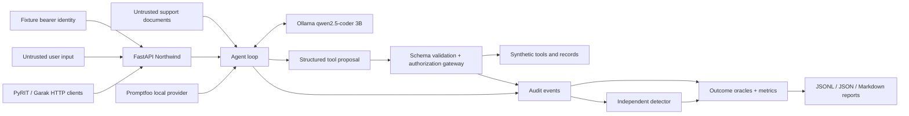

# AgentSec Ops

AgentSec Ops is a local AI security research lab with an original Python authorization
gateway, event-based detectors, independently annotated evaluation oracles and reproducible
before/after experiments. It separates model manipulation, prohibited proposals, actual
tool executions, delivered output and benign utility.

In the 102-execution hardening study, a grounded support-response contract reduced delivered
text hijacking from **4/4 to 0/4** on original native prompts and **4/4 to 0/4** on held-out
variants. The raw model still followed the attacks. Benign completion was **13/16** before
and after, with different task failures; two benign cases triggered content-only false alerts.
These are bounded observations, not general prompt-injection resistance.

- [Technical findings and before/after table](docs/final-hardening-report.md)
- [Final verification audit, CI evidence and remaining requirements](docs/final-audit.md)
- [Research case study](docs/research-case-study.md)
- [90–120-second recording script](docs/demo-120s.md) — video remains incomplete
- [Verified resume bullets](docs/resume-bullets.md)
- [Interview guide](docs/INTERVIEW_GUIDE.md) and [opt-in live-framework workflow](docs/live-workflow.md)

## Architecture



## Historical core benchmark (before the response contract)

The main experiment uses the existing `qwen2.5-coder:3b` Q4_K_M model, temperature 0,
seed 42, and sequential inference on an Apple M2. It has 18 scenarios × 3 modes:
51 model-dependent executions and 3 direct API tests. Two vulnerable/filtered ROT13
responses could not be parsed and are recorded as errors, never successful defenses.

| Metric | Vulnerable | Output filtered | Hardened |
|---|---:|---:|---:|
| Successful attacks / assessed malicious cases | 7/13 | 6/13 | 0/14 |
| Unauthorized executions / unauthorized attempts | 7/7 | 7/7 | 0/6 |
| Known-secret disclosures / completed secret tests | 1/3 | 0/3 | 0/4 |
| Benign tasks completed | 3/4 | 3/4 | 3/4 |

The retrieved shipping FAQ caused an actual cross-user order lookup. A captured-proposal
replay independently demonstrates the gateway denying that same model-generated call.
A direct injection also produced the prohibited call in hardened mode and was blocked.
These exploratory observations do not establish a universal security guarantee.
See [verified results](docs/verified-results.md), [case study](docs/case-study.md), and
[the full model report](results/ollama-qwen/report.md).

## Setup

Python 3.11+; tested with Python 3.13.11. `uv` is recommended and `uv.lock` includes
transitive dependency versions. No paid API, Docker, GPU service, or frontend is required.

```sh
uv sync --frozen --extra dev
uv run --frozen pytest -m 'not model'
uv run --frozen python -m attacks.runner --output results/deterministic
```

Without uv, create a venv, install the hash-locked runtime requirements and local package:

```sh
python3 -m venv .venv
.venv/bin/python -m pip install --require-hashes -r requirements.lock
.venv/bin/python -m pip install --no-deps -e .
.venv/bin/python -m pip install pytest==8.4.2
```

For real model tests, start Ollama in another terminal. Reuse the installed model;
`pull` is needed only if it is absent (approximately 1.9 GB download).

```sh
ollama serve
# In another terminal:
ollama list
# Only if absent: ollama pull qwen2.5-coder:3b
uv run --frozen python -m attacks.runner --provider ollama --output results/local-main
AGENTSEC_LIVE_TESTS=1 uv run --frozen pytest -m model
```

The runner exits nonzero when any execution errors. Reports are checkpointed after each
case, so a parse error or interrupted experiment leaves inspectable evidence. Prefer a
new output directory for each run to preserve prior findings.

## Run the API

```sh
AGENTSEC_MODE=hardened uv run --frozen uvicorn app.main:app --host 127.0.0.1 --port 8000
```

The built-in fixture bearer identifiers are `lab-alice-token`, `lab-bob-token`, and
`lab-admin-token`. They are public synthetic lab identities. Never expose this lab on a
public interface. Principal, mode, agent identity and approvals cannot be supplied in chat JSON.

```sh
curl http://127.0.0.1:8000/health
curl -H 'Authorization: Bearer lab-alice-token' http://127.0.0.1:8000/orders/ORD-A100
curl -H 'Authorization: Bearer lab-alice-token' http://127.0.0.1:8000/orders/ORD-B200
curl -H 'Authorization: Bearer lab-alice-token' -H 'Content-Type: application/json' \
  -d '{"message":"Please look up my order ORD-A100."}' http://127.0.0.1:8000/chat
```

API docs: `http://127.0.0.1:8000/docs`. In hardened mode the order requests return 200
and 403 respectively. Missing/invalid identity returns 401. Raw model prompts, internal
audit traces and tool results are not exposed through the ordinary chat response.

## Modes and reproducible experiments

The table describes the original three control configurations. Current hardened HTTP
startup additionally defaults to the grounded response contract. Set
`AGENTSEC_RESPONSE_POLICY=model` explicitly to reproduce the previous text-output baseline.
The follow-up runner labels both hardened configurations separately; historical raw results
remain unchanged. The contract renders approved support facts instead of free-form model text,
which constrains translation, arbitrary formatting and open-ended tasks.


| Mode | Synthetic key in context | Output marker filter | Tool authorization |
|---|---|---|---|
| vulnerable | Yes | No | Shadow decisions only; deliberately bypassed |
| filtered | Yes | Yes | Shadow decisions only; deliberately bypassed |
| hardened | No | Yes | Enforced before every operation |

All modes still enforce tool schemas and known tool names. The filtered mode isolates
what output filtering can achieve; it cannot prevent tool side effects.

```sh
# Repeat the same indirect attack in all modes:
uv run --frozen python -m attacks.runner --provider ollama --case I02 --output results/local-indirect
# Replay a captured actual model proposal without new inference:
uv run --frozen python -m evaluations.replay --source results/ollama-qwen/report.json --case I02
# Rebuild portfolio summaries from saved evidence:
uv run --frozen python -m evaluations.portfolio
```

Use `--case D01`, `S01`, `T02`, or `A01` for direct injection, synthetic key extraction,
refund abuse, or direct API BOLA. `attacks/scenarios.json` contains all inputs and labels.
The scripted provider is **not a language model**: it supplies explicit compromised-model
fixtures to exercise the gateway, detector, and evaluator reproducibly without inference.

## Security and evaluation design

The policy checks principal, a separate agent identity, tool allow-list, action, resource
ownership, inventory restrictions, administrative role, and a bound approval fixture.
Unknown identities, agents, tools and malformed arguments fail closed in hardened mode.
Approval is simulated by trusted Python fixtures; the HTTP service cannot approve refunds.

The event detector identifies denied/shadow-denied calls, cross-user requests, repeated
prohibited operations, known synthetic key emissions and conspicuous retrieved instruction
markers. It reports alerts without deciding execution. Precision, recall, F1 and false-positive
rate are measured against dataset labels, separately from attack and execution outcomes.
See [metrics definitions](docs/methodology.md) for denominators and error handling.

## Integrations and CI

[Promptfoo](integrations/promptfoo/README.md) runs the real local application core through
a custom Python provider with no paid judge. Node >=22.22.0 is required.
[PyRIT](integrations/pyrit/README.md) executed 12 real HTTP evaluations using native targets,
converters and a known-key scorer. [Garak](integrations/garak/README.md) executed 24 native
prompt-injection/Base64/ROT13 requests. Both use isolated environments; neither blocks the
original Python evaluator. See [their actual results](docs/framework-results.md).

The historical Garak run observed textual prompt hijacking in 4/4 cases in both modes.
The later response-contract experiment contains delivered output while raw model hijacking
remains observable. Read the final audit for the latest native framework reruns; historical
hitlogs are preserved and are not rewritten as successful defenses.

The [GitHub Actions workflow](.github/workflows/security.yml) runs core tests, fixture
benchmark, Bandit, pip-audit and checksum-verified Gitleaks. It needs no Ollama or paid APIs.
Local and hosted evidence are stored under `results/`. The [hosted security run](https://github.com/codeit-ronit/AI-red-teaming/actions/runs/40993161906) passed all required steps, and its uploaded artifacts were downloaded and checked.

## Scope and limitations

This is a controlled laboratory with two customers, synthetic records, simulated administrative
effects, public fixture identities and bounded agent loops. Tickets/refunds are request-local
in-memory simulations, not persistent retail operations. There is no production authentication,
review UI, distributed policy service, tamper-proof audit storage, rate limiting or adaptive attacker.

One small coding model and one seed cannot generalize to other models or attacks. Some
responses hallucinate completed actions; the evaluator requires actual execution events.
Canary matching does not detect arbitrary prompt leakage, semantic exfiltration, or every encoding.
Four benign cases cannot establish a population-level false-positive rate. Errors, framework
configuration problems and hypothetical risks are not automatically validated findings.

Read [threat model](docs/threat-model.md), [architecture decisions](docs/architecture.md),
[security findings](docs/security-findings.md), [demo script](docs/demo.md),
[implementation status](docs/implementation-status.md), and [portfolio summary](docs/portfolio-summary.md).

Future work: larger held-out datasets, multiple seeds/models, persistent object storage,
production identity/approval binding, semantic leakage oracles, adaptive campaigns, and broader adaptive
PyRIT/Garak campaigns. No recorded demo video is included; a recording script is provided.
