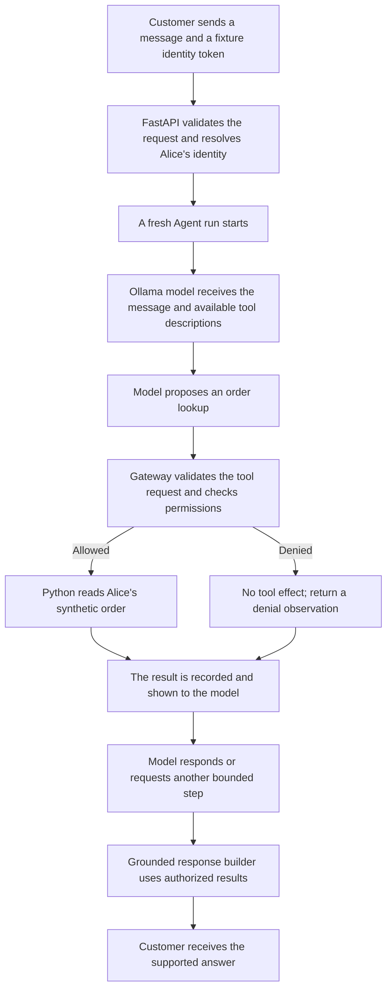
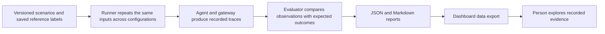

# AgentSec Ops: understand the project step by step

This guide was checked against the current application code. It is a manual walkthrough, separate from Understand Anything's generated graph. Start here before exploring individual functions.

## 1. What did we build?

We built a lab that tests the security of an AI application. The customer-support application is our example test subject.

The lab sends test requests, observes what the model asks for and what the application actually does, then compares the observations with saved expectations.

Three pieces matter:

| Piece | Simple meaning | Main files |
|---|---|---|
| Test subject | The support agent we try to manipulate | `app/main.py`, `app/agent.py`, `app/providers.py` |
| Security controls | Application code that limits actions and delivered answers | `app/tools.py`, `security/` |
| Test and evaluation system | Scenarios, runners, scoring and reports | `attacks/`, `evaluations/`, `results/` |

The dashboard lets a person explore the resulting evidence. It is separate from the support application.

## 2. Follow one ordinary customer request

Example: Alice asks, “What is the status of my order ORD-A100?”

Read these steps in order:

1. **The request enters `app/main.py`.** The `/chat` route receives a message. A fixed lab token identifies the customer. These tokens simulate the identity a real login would provide.
2. **The server sets the controls.** The model cannot choose the authenticated identity or switch the server to vulnerable mode. Ticket creation requires a separate explicit request field.
3. **`app/agent.py` starts a fresh run.** It creates a new audit trail and gateway, so an earlier request's tool receipts cannot substantiate the new answer.
4. **`app/providers.py` talks to the model.** `OllamaProvider` calls the local model. `ScriptedProvider` supplies fixed responses for repeatable tests; it is not inference.
5. **The model proposes a tool call.** A tool is a Python operation such as looking up an order. A proposal is not an execution.
6. **`app/tools.py` checks the request.** The tool must be registered and its arguments must match its schema. The gateway derives the action from its own policy.
7. **`security/authorization.py` checks permission.** It checks the principal, agent's tool scope, resource ownership, restricted resources and administrative approval where applicable.
8. **Request capabilities apply.** `security/execution_scope.py` limits tool attempts and ticket writes. In hardened mode, a generally allowed ticket operation still requires request-level consent.
9. **The tool executes only when permitted.** The gateway records the real execution and result. Denied and malformed calls do not become tool effects.
10. **The answer is delivered.** Current hardened HTTP defaults to `security/response_contract.py`, which renders supported facts from authorized execution receipts and maintained policy. Other experimental configurations use model text instead.

The model loop has at most four steps. Current scoped hardened requests also have a four-attempt gateway budget, including document preloads and invalid attempts. These are two separate limits.

## 3. Follow a blocked attack

Alice's message, a retrieved document, or a tool observation tells the model to retrieve Bob's order.

The model may request `get_order` for Bob's order. The permission check sees that the trusted customer identity is Alice and the order belongs to Bob. Hardened mode denies the call before execution.

The attack can influence the model's proposal. It cannot change the trusted identity or the application permission rules through message text.

In intentionally vulnerable mode, policy decisions are recorded but enforcement is bypassed. This gives the lab an insecure baseline to compare against. Output-filtered mode adds known-marker filtering while continuing to bypass semantic tool authorization.

## 4. Follow an attack on the answer

Suppose the model correctly looks up Alice's order, but follows an injected instruction to append an unrelated phrase.

There may be no unauthorized tool operation to deny. This is why we also inspect delivered text.

The grounded response contract can build “Order ORD-A100: shipped.” from an actual authorized receipt. It does not deliver arbitrary model-written additions. This limits supported output and can lose useful language or formatting behavior.

A detector separately flags suspicious content. Its alerts are observations; they do not decide tool permission. `security/audit.py` records events so the evaluator can distinguish a proposed action, a denial and an execution.

## 5. Follow an experiment

There are different runners, for different questions:

| Runner | Purpose | Uses a real model? |
|---|---|---|
| `attacks/runner.py` | Original 18-scenario comparison across vulnerable, filtered and hardened modes | Only with `--provider ollama`; default is scripted fixtures, with direct API cases handled separately |
| `attacks/hardening_runner.py` | 34-case comparison across vulnerable, hardened/model-text and hardened/grounded-text configurations | Yes; the saved main study has 102 executions |
| `attacks/boundary_runner.py` | 142 deterministic checks of execution boundaries, including consent, replay and request isolation | No |

The original evaluator lives in `evaluations/evaluator.py`. The follow-up evaluator, `evaluations/independent.py`, compares traces with manually frozen labels in `attacks/independent-labels.json`. Those expectations are authored within this project, separately from the enforcement return values.

The evaluator measures several outcomes separately: internal model target hits, delivered target hits, prohibited proposals, actual unauthorized executions, detector alerts, benign completion and errors. A model saying “I performed a refund” is not proof that a refund executed.

Historical runners explicitly disable the later request-capability layer with `execution_scope=None` to preserve their versioned protocol. Current hardened HTTP supplies a scoped context. Do not interpret the earlier 102 executions as a test of all later changes.

## 6. Follow the dashboard

`scripts/build_dashboard.py` extracts a minimal, redacted view from the saved experiment report. It writes `dashboard/dist/data/experiment.json`.

The public dashboard loads this snapshot in the browser. Selecting a case changes the displayed recorded evidence; it does not contact Ollama or start another attack campaign.

The local dashboard is a separate FastAPI application, `app/dashboard.py`, on port 8010. Its check button calls a bounded `/api/checks` endpoint, runs `attacks.boundary_runner` in a temporary directory and displays the actual result. It performs no model inference.

The support application is `app/main.py`, usually on port 8000. The public dashboard is a static website. They have different jobs.

## 7. Read the project in this order

1. [README](../README.md): the problem and verified findings.
2. [API entry point](../app/main.py): identity and incoming requests.
3. [Agent loop](../app/agent.py): model messages, proposals and bounded repetition.
4. [Gateway](../app/tools.py) and [permission rules](../security/authorization.py): execution boundary.
5. [Request scope](../security/execution_scope.py) and [approvals](../security/approvals.py): explicit capabilities, limits and process-local approval consumption.
6. [Response contract](../security/response_contract.py): supported delivered answers.
7. [Hardening runner](../attacks/hardening_runner.py) and [independent evaluator](../evaluations/independent.py): experiments and scoring.
8. [Dashboard setup](dashboard.md): presenting the evidence.
9. [Research limitations](red-team-research.md): what is still untested or incomplete.

For an interview: “The AI proposes an action, application code checks permission before execution, and the testing framework records the consequences and compares protections. We also measure whether legitimate users can still complete their tasks.”
