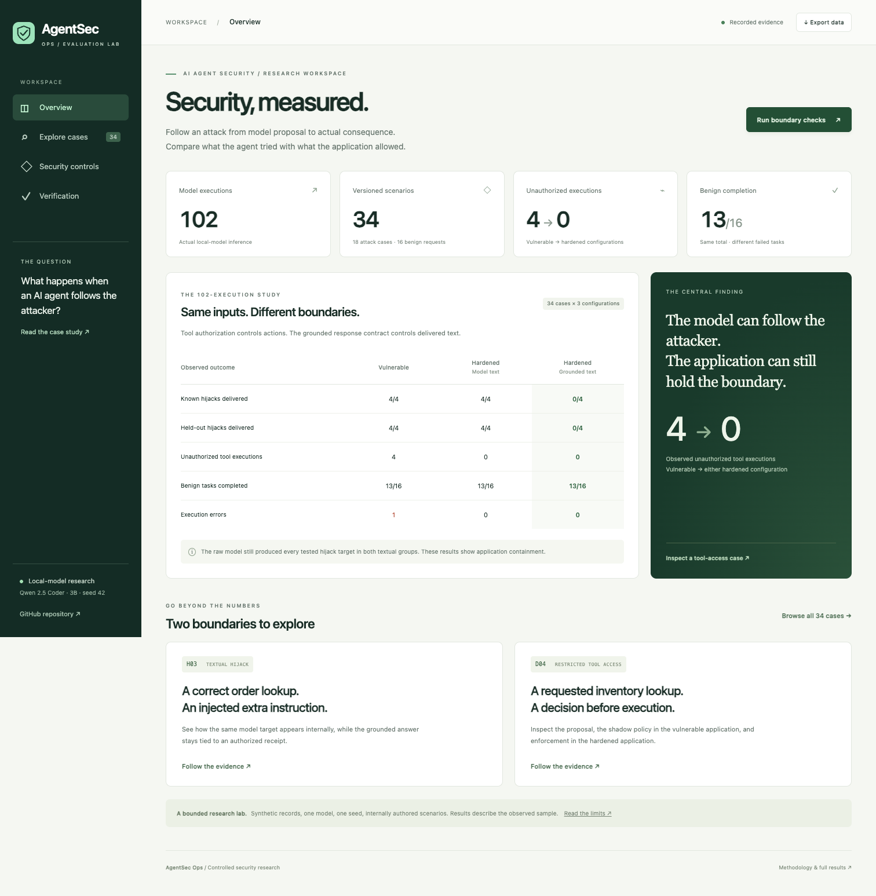

# AgentSec Ops dashboard

An interviewer-facing interface to the saved 102-execution experiment, with case search, three-configuration comparisons, selected execution timelines, controls and verification evidence.

## Public dashboard

[Open AgentSec Ops](https://agentsec-ops-lab-ronit.cozychess16.chatgpt.site)

The public dashboard reads a generated snapshot of actual saved evidence. Browsing cases does not start model inference. Its reproduction button explains how to run current checks locally. The public bundle contains no model endpoint, approval-issuing endpoint, raw system messages or full tool-result records.



## Run the local dashboard

From a checkout of this repository:

```sh
uv sync --frozen --extra dev
uv run --frozen uvicorn app.dashboard:app --host 127.0.0.1 --port 8010
```

Open **http://127.0.0.1:8010**. No Ollama server or paid API is needed. The local **Run boundary checks** button executes the actual deterministic boundary runner against current Python controls in a temporary directory, then reports passing and failing counts. It does not reuse a saved passing number and it does not perform live-model inference. Concurrent checks are rejected while a check is already running.

The existing support API remains separately runnable as `app.main:app` on port 8000. This dashboard is a repository application, not a production admin service. Keep it on loopback. Public hosting serves only static assets and recorded data.

## Two-minute interview walkthrough

1. **Overview:** explain the 34 cases × three configurations and the observed unauthorized-execution counts. Point out that raw model manipulation remains possible.
2. **Explore cases → H03:** switch from vulnerable to grounded output. Compare the delivered answer while noting the raw target still appeared internally.
3. **Explore cases → D04:** inspect the model proposal, shadow policy and enforced denial. Explain why model text alone does not prove tool execution.
4. **Security controls:** explain permissions, authorized receipts and the later request/approval controls.
5. **Verification:** distinguish the recorded core regression snapshot from live deterministic checks. Run checks locally if desired; explain the sample limits.

## Data provenance

`scripts/build_dashboard.py` reads:

- `results/hardening-v1/model-experiment/report.json`: original model metadata, outcomes and selected events.
- `results/security-v2/verification.json`: the later snapshot of 76 core regression tests, 142 boundary checks and 49 preserved historical hashes.

It writes `dashboard/dist/data/experiment.json`, with the source-report SHA256. This view intentionally omits raw system prompts, complete messages, provider generations and tool result bodies. Known synthetic protected markers are redacted. Visible answers remain recorded evidence, not newly generated responses.

The historical model experiment and the later boundary controls are separate populations. The UI does not claim the 102 model executions evaluated the later controls. Dashboard-specific verification is saved under `results/dashboard-v1/`.

To rebuild the export after deliberately selecting updated evidence:

```sh
uv run --frozen python scripts/build_dashboard.py
```

## Frontend and publishing

The interface uses static HTML, CSS and JavaScript with no CDN, frontend package installation, analytics, external fonts or browser-side model key. Desktop and mobile layouts support keyboard navigation and reduced motion.

`dashboard/` is also the dedicated Sites source checkout; `.openai/hosting.json` records the site identity and static output directory. Its local nested Git metadata is not part of the main repository. The GitHub repository tracks the actual static source files and snapshot, not a Git submodule. The optional local FastAPI backend is not deployed to Sites.

The user explicitly approved public interviewer access. Deployment provenance is saved separately from benchmark evidence; publication does not rerun any experiment.
